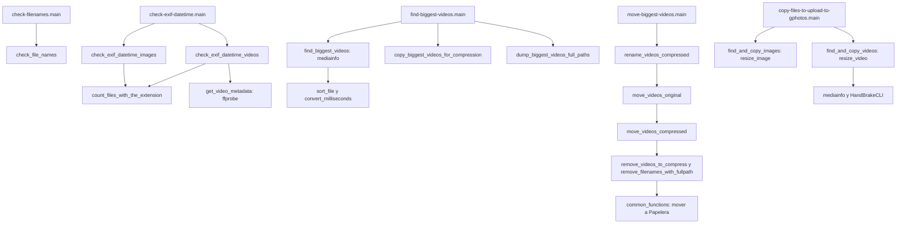

# Preparación actual

Los comandos del README presuponen estar en `src/`, aunque no lo indican de
forma consistente: los scripts se invocan por nombre, los logs usan `./logs/`
y las carpetas de compresión usan `../`. Desde la raíz se necesita `cd src`
y activar el entorno con `source ../.venv/bin/activate`, si se creó en la raíz.
Las dependencias Python se declaran en `src/requirements.txt`:
`Pillow==12.0.0` y `progress==1.6.1`.[^source]

El README propone instalar FFmpeg, MediaInfo, HandBrake y gphotos-uploader-cli.
Los ejecutables que llama el código son `ffprobe`, `mediainfo`, `HandBrakeCLI`
y las utilidades de shell `find`/`wc`. No hay gestor del proceso ni comprobación
central de dependencias. Ningún script del repositorio llama a `gphotos-uploader-cli`.[^readme]

# Recorrido completo

| Paso del README | Ejecución efectiva | Intervención o resultado |
| --- | --- | --- |
| 1–3 | Comprobar cargas del móvil, copiar Dropbox → Google Drive y descartar imágenes | Todo manual; el script de importación mencionado no existe. |
| 4 | `check-filenames.py --dir …`, primero sin y después con `--do_rename` | Detecta reglas históricas y aplica una parte de los renombrados. |
| 5 | Búsqueda en Finder y conversión con Permute | No hay conversión a MP4 en estos scripts. |
| 6 | `check-exif-datetime.py --dir … [--do_rename]` | Compara fechas; con la opción añade prefijos. La corrección con Attributes/Rename es manual. |
| 7–9 | `find-biggest-videos.py --dir …` y HandBrake | Selecciona vídeos de al menos 50 MB decimales, los copia y guarda rutas; compresión y revisión del tamaño manuales. |
| 10 | A Better Finder Attributes sobre los comprimidos | Corrección manual de fechas tras comprimir. |
| 11 | `move-biggest-videos.py` | Renombra comprimidos, aparta originales, instala comprimidos y lleva temporales a la Papelera. Indica hacer backup y mover originales desde Google Drive web. |
| 12 | `copy-files-to-upload-to-gphotos.py --source … --destiny … --copy_images --copy_videos --video_preset veryfast480p` | Crea derivados JPG de hasta 1200 px y vídeos usando HandBrakeCLI. |
| 13 | `check-exif-datetime.py --dir <exportación> [--do_rename]` | Otra auditoría y corrección externa de fechas sobre los derivados. |
| 14 | `gphotos-uploader-cli push --debug` seguido de copia de su estado | Es una orden externa escrita en el README; no forma parte de los scripts Python. |

La tabla sigue el procedimiento escrito; sus límites están en las fichas de
[auditoría](auditoria-actual.md), [vídeos](videos-actual.md) y
[exportación](exportacion-actual.md).[^readme][^source]

# Llamadas internas

Cada `main()` se ejecuta de forma independiente; las flechas representan llamadas
o el orden interno, no un orquestador existente.[^source]

# Estado compartido y finalización

El traspaso entre selección y sustitución de vídeos depende de archivos
`<nombre>_full_path.txt` en las dos carpetas de trabajo. No existe un manifiesto,
estado por archivo, bloqueo entre ejecuciones ni reanudación formal. Los logs
no son una interfaz estable de resultados. Las incidencias registradas no se
traducen de forma uniforme a códigos de salida distintos de cero.[^source]

[^readme]: [README original](https://github.com/senechaux/check-media-library-names-and-dates/blob/bf3554fab9a04414c3f369ecc4a9fc2dcdbb297c/README.md).
[^source]: [Código analizado](https://github.com/senechaux/check-media-library-names-and-dates/tree/bf3554fab9a04414c3f369ecc4a9fc2dcdbb297c/src).
